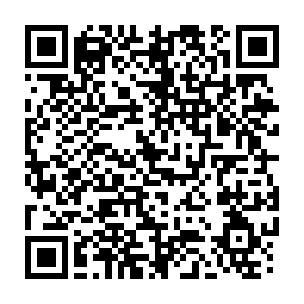
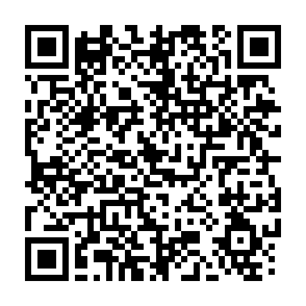
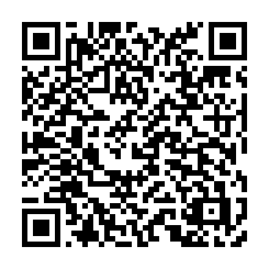
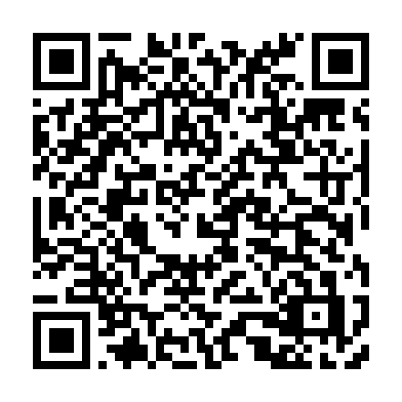
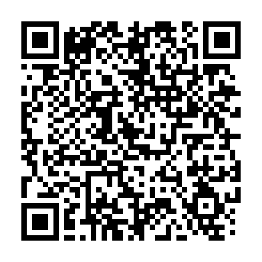

# 🌍 سابسکریپشن Shadowmere بر اساس کشور

[](https://github.com/amepartito/usa-sub/actions/workflows/update.yml)

**25 کشور و 190 کانفیگ** در آخرین دریافت موفق ثبت شده‌اند. هر کشور یک لینک ثابت و یک QR Code مخصوص خودش دارد.

## 🔗 لینک ثابت کشورها

```text
https://raw.githubusercontent.com/amepartito/usa-sub/main/subs/<code>
```

فقط دو حرف آخر لینک را تغییر بده: `us` آمریکا، `fr` فرانسه، `de` آلمان و غیره. کدها حروف کوچک هستند.

| کشور | کد | اشتراک | QR Code |
|---|---|---|---|
| 🇺🇸 آمریکا | `us` | [لینک ساب](https://raw.githubusercontent.com/amepartito/usa-sub/main/subs/us) | [📷 QR](qr/us.png) |
| 🇫🇷 فرانسه | `fr` | [لینک ساب](https://raw.githubusercontent.com/amepartito/usa-sub/main/subs/fr) | [📷 QR](qr/fr.png) |
| 🇩🇪 آلمان | `de` | [لینک ساب](https://raw.githubusercontent.com/amepartito/usa-sub/main/subs/de) | [📷 QR](qr/de.png) |
| 🇬🇧 بریتانیا | `gb` | [لینک ساب](https://raw.githubusercontent.com/amepartito/usa-sub/main/subs/gb) | [📷 QR](qr/gb.png) |
| 🇳🇱 هلند | `nl` | [لینک ساب](https://raw.githubusercontent.com/amepartito/usa-sub/main/subs/nl) | [📷 QR](qr/nl.png) |
| 🇨🇦 کانادا | `ca` | [لینک ساب](https://raw.githubusercontent.com/amepartito/usa-sub/main/subs/ca) | [📷 QR](qr/ca.png) |
| 🇯🇵 ژاپن | `jp` | [لینک ساب](https://raw.githubusercontent.com/amepartito/usa-sub/main/subs/jp) | [📷 QR](qr/jp.png) |

**[🌐 فهرست تمام کشورها، تعداد کانفیگ‌ها و QR مخصوص هر کشور](https://github.com/amepartito/usa-sub/blob/main/COUNTRIES.md)**

## 📷 QR Code آماده اسکن

<a href="qr/us.png"></a>
<a href="qr/fr.png"></a>
<a href="qr/de.png"></a>
<a href="qr/gb.png"></a>
<a href="qr/nl.png"></a>

این QRها **آدرس سابسکریپشن** را دارند، نه تنظیمات یک سرور؛ با آپدیت فهرست سرورها نیازی به تغییر یا اسکن دوباره QR نیست.

- با یک دستگاه QR را باز کن؛ در گوشی دوم وارد `Hiddify` یا `Streisand` شو، `+` و سپس `Scan QR` را بزن.
- اگر تنها یک گوشی داری، لینک کشور را کپی کن؛ یا اگر برنامه امکان خواندن QR از گالری را دارد، تصویر را ذخیره و از گالری انتخاب کن.
- بعد از وارد شدن پروفایل، با گزینه `Update/Refresh` فهرست جدید سرورها را دریافت کن.

## 🔄 به‌روزرسانی خودکار

- GitHub Actions هر **۳ ساعت** تلاش می‌کند داده‌های تازه Shadowmere را دریافت کند؛ اجرای زمان‌بندی‌شده ممکن است تأخیر داشته باشد.
- ساب‌ها در `subs/xx` و تصویرهای QR در `qr/xx.png` منتشر می‌شوند.
- اگر دریافت منبع ناموفق شود، اجرا با خطا متوقف می‌شود و فایل‌های منتشرشده قبلی دست‌نخورده می‌مانند.
- اگر کشوری دیگر سرور فعال برچسب‌دار نداشته باشد، فایل ساب و QR آن کشور در اجرای موفق بعدی حذف می‌شوند.
- [نمایش اجراها و اجرای دستی](https://github.com/amepartito/usa-sub/actions/workflows/update.yml)

## 🧹 ساختار پروژه

```text
.github/workflows/update.yml    به‌روزرسانی خودکار
subs/us                         ساب آمریکا
subs/fr                         ساب فرانسه
subs/de                         ساب آلمان
qr/us.png                       QR آمریکا
qr/fr.png                       QR فرانسه
qr/de.png                       QR آلمان
COUNTRIES.md                    فهرست خودکار کشورها و QRها
README.md                       راهنمای فارسی در GitHub
```

فایل قدیمی `us.txt` و فایل‌های تکراری `.txt` ساخته نمی‌شوند. **لینک نهایی آمریکا همیشه `.../subs/us` است.**

## ⚠️ نکات مهم

- منبع: [Shadowmere](https://shadowmere.xyz/)؛ تنها پروتکل **Shadowsocks** و فرمت Base64 از منبع فعلی منتشر می‌شود.
- فعال‌بودن سرور نزد Shadowmere به معنی اتصال تضمینی از اینترنت تو نیست.
- کشور از پرچم کنار نام کانفیگ مشخص می‌شود، نه تست مستقل موقعیت IP خروجی.
- این پروژه صرفاً کانفیگ‌های منبع عمومی را تفکیک می‌کند و سرور VPN ارائه نمی‌دهد.
